# Yerlem — Filo ve Rotalama

Araçların tek bir ortak filo kaynağından yönetildiği, aynı araçlarla duraklı rota planlarının
hazırlandığı web uygulaması. 360 px telefon ekranından masaüstüne kadar kullanılabilir.

**Teknolojiler:** React · Material UI · Zustand · Node.js (Express + TypeScript) · PostgreSQL (Knex) · Docker

[](https://github.com/betlkorkmaz/yerlem-filo-rotalama/actions/workflows/ci.yml)

---

## 📸 Ekran Görüntüleri

| Rota planlama (masaüstü) | Araç listesi (masaüstü) |
|---|---|
| 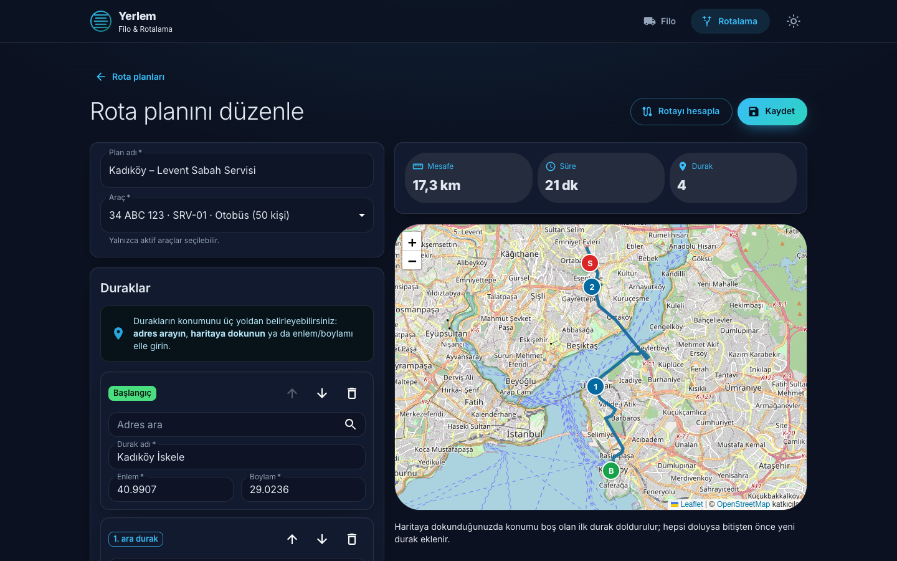 | 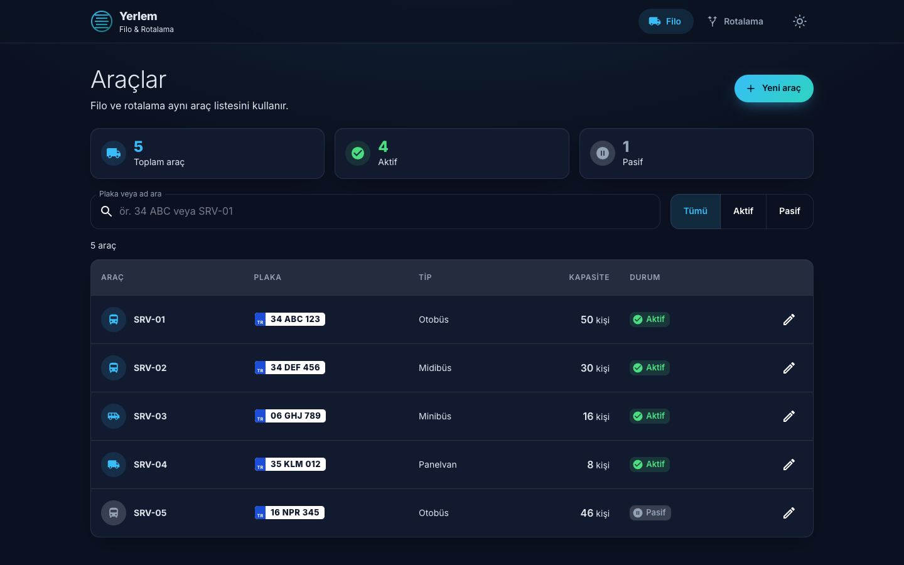 |
| **Rota planları** | **Form doğrulama** (alanla ilişkili hata mesajları) |
| 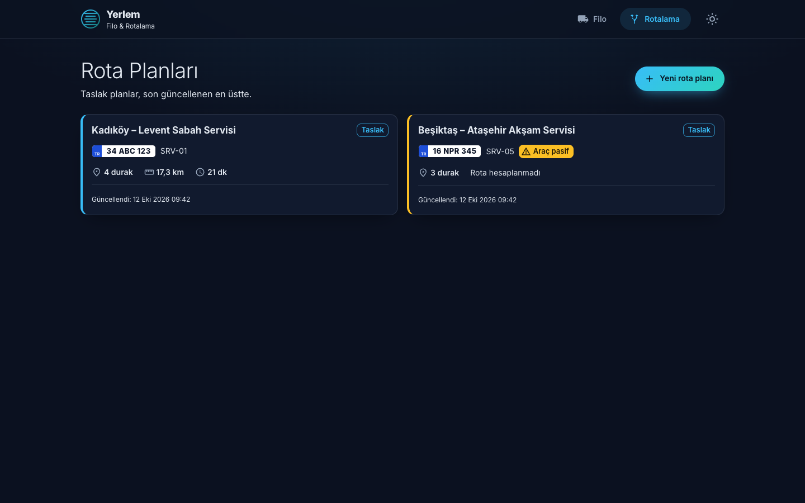 | 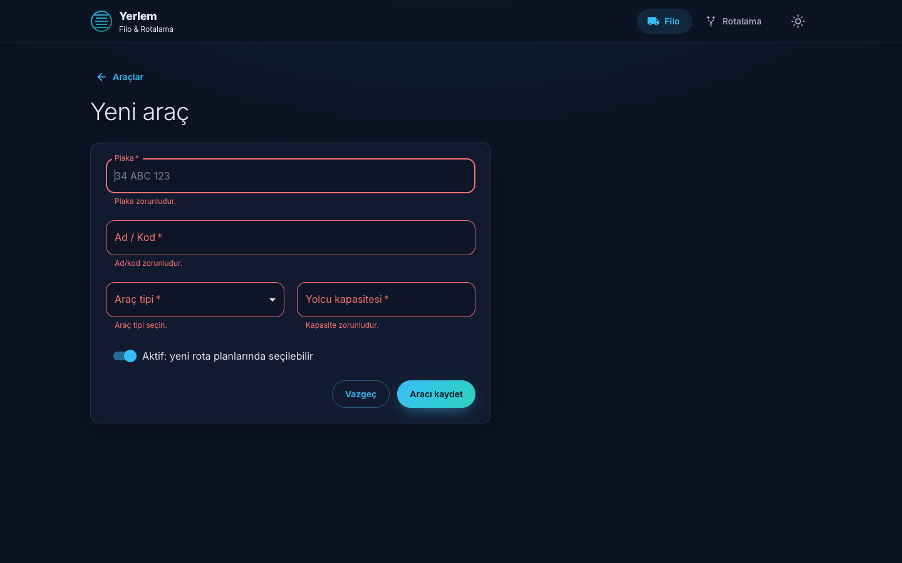 |
| **Açık tema** | **API dokümanı (Swagger)** |
| 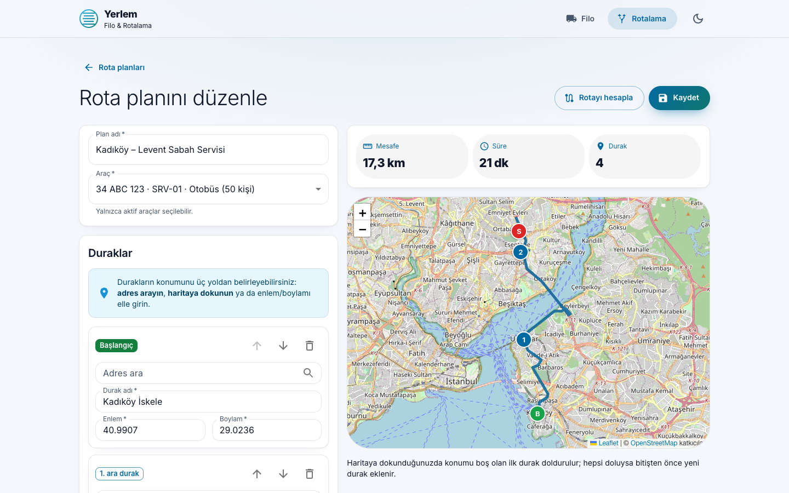 | 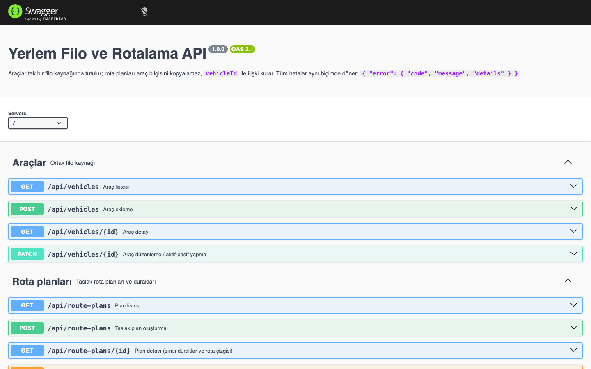 |

**Mobil (360 px)**

| Araç listesi | Rota planları | Rota planlama | Pasif araç ve geçmiş planı | Açık tema |
|---|---|---|---|---|
| 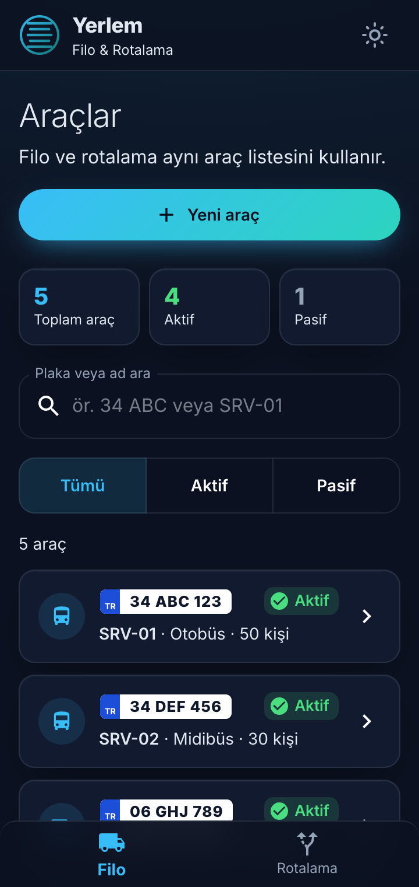 | 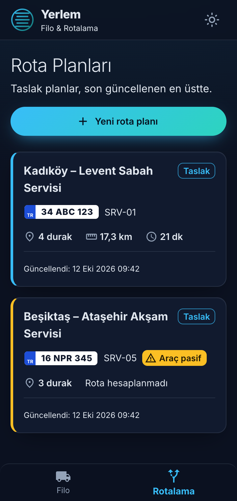 | 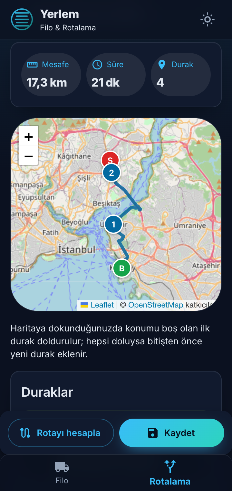 | 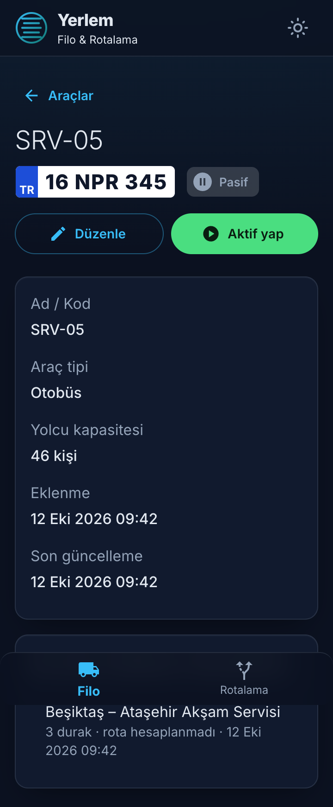 | 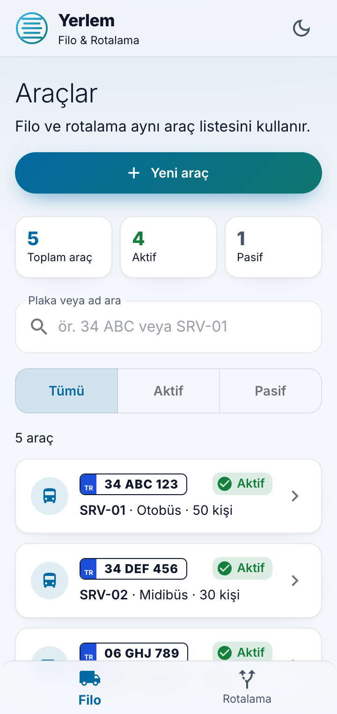 |

---

## ✅ Kapsam

| Gereksinim | Karşılığı |
|---|---|
| Filo: listeleme, arama, aktiflik filtresi, ekleme, düzenleme, aktif/pasif, detay | `/vehicles` ekranları; fiziksel silme yok, pasif yapma var |
| Plaka benzersiz, yazım farkları tutarlı | Normalizasyon + `UNIQUE` kısıtı → `409 PLATE_TAKEN` |
| Rotalama: başlangıç, bitiş, ara duraklar, yeniden sıralama | Durak listesi (↑ ↓), adres arama, haritaya dokunarak ekleme |
| Yalnızca aktif araç; geçersiz koordinat kaydedilmez | Kayıt anında kilitli kontrol (`409 VEHICLE_INACTIVE`); `CHECK` kısıtları + doğrulama |
| Harita, toplam mesafe ve süre | Leaflet + OpenStreetMap, OSRM |
| Taslak kaydetme ve tekrar açma | `/routes`, `/routes/:id`; rota çizgisi plana kaydedilir |
| Ortak veri | Araçlar tek tabloda; plan `vehicle_id` ile ilişkili; istemcide tek araç store'u |
| Mobil (360 px), durum ekranları, erişilebilirlik | Kart görünümü, sabit eylem çubuğu, yükleniyor/boş/sonuç yok/hata ekranları, alanla ilişkili hata mesajları, görünür odak |
| Docker, migration, seed | `docker compose up --build`; 5 araç + 2 plan |
| Test, lint, API dokümanı | 41 test, ESLint, Swagger (`/api/docs`), GitHub Actions CI |

---

## 🚀 Kurulum ve Çalıştırma

Tek gereksinim **Docker** (Docker Desktop veya Docker Engine + Compose v2).

```bash
git clone https://github.com/betlkorkmaz/yerlem-filo-rotalama.git
cd yerlem-filo-rotalama
docker compose up --build
```

İlk açılışta veritabanı tabloları otomatik oluşturulur ve örnek veri eklenir. Ek bir kurulum
veya `.env` dosyası gerekmez.

| Adres | Açıklama |
|---|---|
| http://localhost:8080 | Uygulama |
| http://localhost:8080/api/docs | **API dokümanı (Swagger)**: uçlar tarayıcıdan denenebilir |
| http://localhost:8080/api/health | Servis ve veritabanı durumu |
| http://localhost:3000/api | Backend (doğrudan erişim) |

**Örnek veri:** 5 araç (biri pasif) ve 2 rota planı. İlk plan hesaplanmış rotasıyla gelir (haritada
hemen görülür). İkinci plan bilerek pasif araca bağlı ve rotasızdır: pasif aracın geçmiş planda
görünmeye devam ettiği ve rota servisi olmadan da taslak kaydedilebildiği bu sayede görülebilir.

```bash
docker compose down        # durdur
docker compose down -v     # durdur ve veritabanını sıfırla (seed tekrar çalışır)
```

Portları veya veritabanı bilgilerini değiştirmek için `.env.example` dosyasını `.env` olarak kopyalayıp düzenleyin.

---

## 🌐 Kullanılan Dış Servisler

Hiçbiri API anahtarı gerektirmez; adresleri ortam değişkenleriyle değiştirilebilir.

| Servis | Kullanım | Ortam değişkeni |
|---|---|---|
| OpenStreetMap karoları | Harita görüntüsü (Leaflet) | — |
| OSRM | Rota mesafesi, süresi ve çizgisi | `OSRM_URL` |
| Nominatim | Adresten konum bulma | `NOMINATIM_URL` |

Rota ve adres servislerine tarayıcıdan değil backend'den gidilir: zaman aşımı ve hata dönüşümü
tek yerde yönetilir, ileride anahtarlı bir servise geçilirse anahtar tarayıcıya sızmaz.

## 🧱 Mimari

```
Tarayıcı ──> frontend (nginx :8080) ──/api──> backend (Express :3000) ──> PostgreSQL
```

- **Tek kaynak:** Araçlar yalnızca `vehicles` tablosunda tutulur. Rota planları araç bilgisini
  kopyalamaz, `vehicle_id` ile ilişki kurar. Filo ve rotalama ekranları aynı API'den ve
  istemcide aynı Zustand store'undan okur.
- **Backend katmanları:** `routes` (HTTP + doğrulama) → `service` (iş kuralları) → `repository` (SQL).
  Tüm hatalar tek biçimde döner: `{ "error": { "code", "message", "details" } }`.
- **Frontend:** Özellik tabanlı klasörler (`features/fleet`, `features/routing`). HTTP çağrıları
  yalnızca `src/api/` katmanında yapılır; ekranlar ağ ayrıntısını bilmez.

Ayrıntılı veri modeli, iş kuralları ve kararların gerekçeleri: **[docs/analiz.md](docs/analiz.md)**

### Klasör yapısı

```
backend/src/
├── db/            migration, seed, bağlantı
├── modules/       özellik bazlı modüller (vehicles, health)
│   └── vehicles/  *.routes.ts · *.service.ts · *.repository.ts · *.schema.ts
├── middleware/    ortak hata yönetimi
└── lib/
frontend/src/
├── api/           HTTP istemcisi ve uç fonksiyonları
├── app/           tema, yönlendirme, ana yerleşim
├── features/
│   ├── fleet/     store · hooks · components · pages
│   └── routing/
└── shared/        ortak bileşenler (durum görünümleri, sayfa başlığı, bildirim)
```

### Zustand store sınırları

| Store | Sorumluluk |
|---|---|
| `useVehicleStore` | Sunucudan gelen araç listesi (filonun istemcideki tek kopyası) |
| `useNotificationStore` | Kısa arayüz bildirimleri |
| `useRoutePlanStore` | Kayıtlı rota planlarının özet listesi |
| `useRouteEditorStore` | Düzenlenen, henüz kaydedilmemiş plan: duraklar, seçili `vehicleId`, hesaplanan rota |

Liste filtreleri store yerine adres çubuğunda (`?q=&status=`) tutulur; form değerleri ilgili bileşende kalır.

---

## 🔌 API

Ayrıntılı sözleşme (istek/cevap şemaları, hata kodları): **http://localhost:8080/api/docs** ·
ham OpenAPI 3.1: `/api/openapi.json` · kaynak: [backend/src/docs/openapi.ts](backend/src/docs/openapi.ts)

| Metot | Uç | Açıklama | Başarılı | Hatalar |
|---|---|---|---|---|
| GET | `/api/health` | Servis durumu | 200 | 503 |
| GET | `/api/vehicles?search=&status=all\|active\|inactive` | Araç listesi | 200 | 400 |
| GET | `/api/vehicles/:id` | Araç detayı | 200 | 400, 404 |
| POST | `/api/vehicles` | Araç ekleme | 201 | 400, 409 |
| PATCH | `/api/vehicles/:id` | Düzenleme / aktif-pasif | 200 | 400, 404, 409 |
| GET | `/api/route-plans?vehicleId=` | Plan listesi (durak sayısı, aracın güncel bilgisi) | 200 | 400 |
| GET | `/api/route-plans/:id` | Plan + sıralı duraklar + rota çizgisi | 200 | 400, 404 |
| POST | `/api/route-plans` | Taslak plan oluşturma | 201 (tekrar isteğinde 200) | 400, 409 |
| PUT | `/api/route-plans/:id` | Taslak planı güncelleme | 200 | 400, 404, 409 |
| POST | `/api/routing/calculate` | OSRM ile rota hesabı (kaydetmez) | 200 | 400, 422, 502, 504 |
| GET | `/api/geocoding/search?q=` | Adresten konum arama (Nominatim) | 200 | 400, 502, 503, 504 |

Araçlar için silme ucu bilerek yoktur; geçmiş planları korumak için araçlar pasif yapılır.

<details>
<summary>Örnek istek ve hata cevabı</summary>

```bash
curl -X POST http://localhost:8080/api/vehicles \
  -H 'Content-Type: application/json' \
  -d '{"plate":" 34 abc 123 ","name":"SRV-01","type":"bus","capacity":50}'
```

```json
{ "error": { "code": "PLATE_TAKEN", "message": "Bu plaka zaten kayıtlı.", "details": { "field": "plate" } } }
```

</details>

---

## 🛠️ Yerel Geliştirme

Docker dışında geliştirmek için Node.js 22+ gerekir.

```bash
# Veritabanı (Docker ile)
docker compose up -d db

# Backend
cd backend
npm install
npm run db:migrate    # migration + seed
npm run dev           # http://localhost:3000

# Frontend (ayrı terminalde)
cd frontend
npm install
npm run dev           # http://localhost:5173 (/api istekleri backend'e yönlendirilir)
```

| Komut | backend | frontend |
|---|---|---|
| Lint | `npm run lint` | `npm run lint` |
| Tip kontrolü | `npm run typecheck` | `npm run typecheck` |
| Test | `npm test` | `npm test` |

## 🧪 Testler

```bash
docker compose up -d db          # entegrasyon testleri için PostgreSQL
cd backend && npm install && npm test
cd frontend && npm install && npm test
```

Backend entegrasyon testleri ayrı bir `yerlem_test` veritabanı oluşturup uygulamanın kendi
migration'larıyla kurar; geliştirme verisine dokunmaz. PostgreSQL'e ulaşılamazsa bu testler hata
vermek yerine **atlanır**, veritabanı gerektirmeyen testler yine çalışır.

| Katman | Dosya | Sınanan davranış |
|---|---|---|
| Backend · iş kuralı | `tests/vehicle.schema.test.ts` | Plaka normalizasyonu, alan doğrulamaları, düzenlemede aktiflik korunur |
| Backend · entegrasyon | `tests/api.integration.test.ts` | Aynı plakanın farklı yazımı (409), eşzamanlı aynı plaka, pasif araçla plan (409), rota açıkken aracın pasifleşmesi, `clientRequestId` ile çift kayıt koruması (5 paralel istek → 1 plan), durak silme/sıralama sonrası sequence, `ON DELETE RESTRICT` |
| Backend · dış servis | `tests/osrm.service.test.ts` | Rota servisi zaman aşımı (504), ulaşılamama/bozuk cevap (502), rota yok ve yola uzak durak (422) |
| Frontend · kullanıcı akışı | `src/features/fleet/pages/VehicleCreatePage.test.tsx` | Boş form → alanla ilişkili hata mesajları; sunucu 409 → mesaj plaka alanında; başarılı kayıt → doğru istek ve yönlendirme; çift tıklamada tek istek |
| Frontend · durum kuralları | `src/features/routing/routeEditor.test.ts` | Ara durak bitişten önce eklenir, durak değişince eski rota silinir, konum doğrulama mesajları |

---

## 📌 Varsayımlar

- Tek bir operasyon ekibi kullanır; kimlik doğrulama ve rol ayrımı kapsam dışıdır.
- Plakalar Türkiye biçimindedir (il kodu 01–81 + 1–3 harf + 2–4 rakam) ve boşluksuz, büyük harfle
  saklanır. `34 abc 123`, `34ABC123` ve ` 34 Abc 123 ` aynı plaka sayılır.
- Araç kapasitesi 1–100 yolcu aralığındadır.
- Filo yüzlerce araç mertebesindedir; araç listesi bir kez çekilip istemcide filtrelenir.
  Daha büyük filolar için backend'deki `search` ve `status` parametreleri hazırdır.

## 🗺️ Rota Planlama Davranışı

- **Konum belirleme:** Kullanıcının koordinat bilmesi beklenmez. Her durak için **adres aranabilir**
  (seçilen sonuç adı ve koordinatı doldurur), **haritaya dokunulabilir** ya da enlem/boylam elle girilebilir.
- **Ara duraklar isteğe bağlıdır:** Plan en az başlangıç ve bitişten oluşur; "Ara durak ekle" ile
  istenen sayıda (en fazla 25 durağa kadar) ara durak eklenir. Gerekçe: [docs/analiz.md](docs/analiz.md#2-varsayımlar).
- **Durak sırası:** Listenin ilki başlangıç, sonuncusu bitiştir. Sıralama yukarı/aşağı butonlarıyla
  yapılır (klavye ve dokunmatikte güvenilir). Kayıtta duraklar 0..n olarak yeniden numaralanır.
- **Rota hesabı ve kayıt ayrıdır:** "Rotayı hesapla" OSRM'den mesafe, süre ve çizgiyi alır;
  "Kaydet" planı bu sonuçla birlikte saklar. Rota servisi çalışmasa da plan rotasız taslak olarak
  kaydedilebilir. Duraklar değişince eski rota otomatik silinir, böylece yanlış rota kaydedilmez.
- **Pasif araç:** Yeni planda seçilemez. Ekran açıkken araç başka yerde pasif yapılırsa kayıt `409`
  ile reddedilir (kontrol, transaction içinde araç satırı `FOR SHARE` ile kilitlenerek yapılır);
  girilen duraklar kaybolmaz.
- **Geçmiş kayıtların sunumu:** Plan aracı kopyalamaz; liste ve detayda aracın **güncel** bilgisi
  ilişkiden okunur. Araç pasif yapılırsa planlar silinmez, "Araç pasif" etiketiyle görünmeye devam
  eder ve araç detay sayfasında listelenir.
- **Çift kayıt:** Kaydet butonu istek sürerken kilitlenir; ayrıca her yeni plan ekranı bir
  `clientRequestId` üretir ve aynı istek tekrar gelirse sunucu yeni kayıt açmaz.
- **Rota servisi hataları:** Zaman aşımı (504), ulaşılamama/bozuk cevap (502), rota bulunamaması veya
  durağın karayoluna çok uzak olması (422) ayrı mesajlarla gösterilir.

## ⚠️ Bilinen Eksikler

- Rota servisi olarak OSRM'in herkese açık **demo sunucusu** kullanılır; yoğunlukta yavaşlayabilir
  ve kullanım sınırı vardır. Üretimde kendi OSRM sunucusu kurulup `OSRM_URL` ile gösterilmelidir.
- Kaydedilen mesafe/süre istemcinin hesapladığı rotadan gelir; backend kayıtta rotayı yeniden
  hesaplayıp doğrulamaz (kaydın rota servisine bağımlı olmaması için).
- Aynı aracı veya planı iki kişi aynı anda düzenlerse son kaydeden kazanır (optimistic locking yok).
- Rota planları silinemez; yalnızca düzenlenebilir.
- Adres arama için OpenStreetMap **Nominatim**'in herkese açık sunucusu kullanılır. Kullanım
  politikası gereği arama yazarken otomatik yapılmaz ("Ara" / Enter ile yapılır), backend istekleri
  saniyede en fazla 1 olacak şekilde sıraya alır ve sonuçları 1 saat önbellekte tutar. Arama Türkiye
  ile sınırlıdır (`GEOCODING_COUNTRY_CODES`).

---

## 🤖 Kullanılan Araçlar ve Yardım Alınan Kısımlar

Geliştirme sürecinde yapay zekâ araçları (**Claude, ChatGPT, Gemini**) yardımcı kaynak olarak
kullanıldı: proje iskeletinin kurulması, kod yazımı, hata ayıklama ve teknik kavramların
araştırılması. Mimari kararlar, veri modeli, uç durumların ele alınışı ve testler incelenip
anlaşılarak projeye dahil edildi; kodun tamamını açıklayabilir ve değiştirebilirim.

Diğer kaynaklar: React, MUI, Zustand, Express, Knex, Zod ve PostgreSQL resmi dokümantasyonları.
