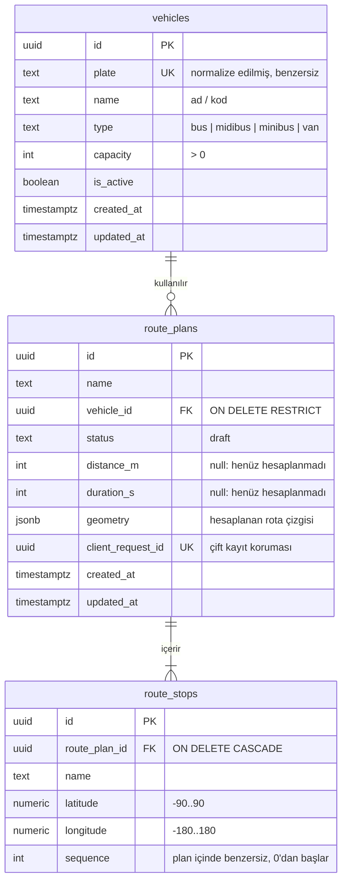
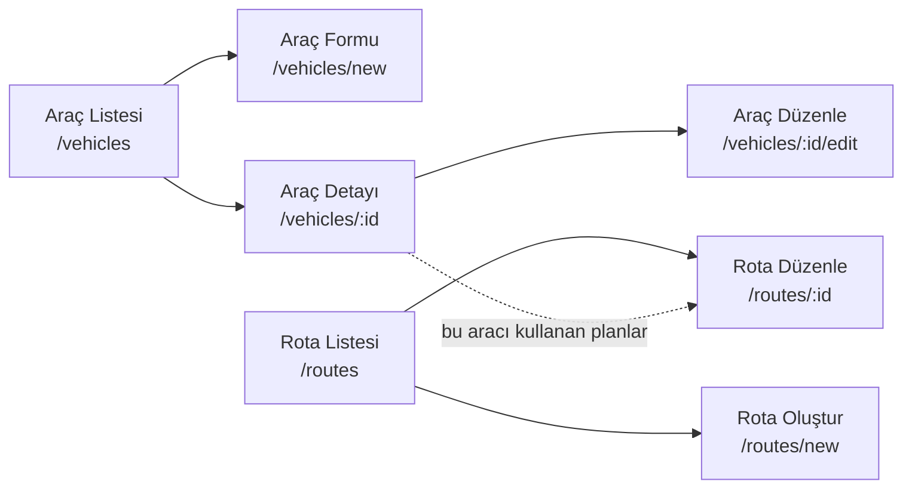

# Analiz ve Tasarım Notu

Bu doküman geliştirmeye başlamadan önce yapılan analizi, veri modelini, ekran akışını ve
temel teknik kararları içerir. Geliştirme sırasında değişen kararlar burada güncellenir.

## 1. Problem

Bir ulaşım operasyonunda araçlar iki farklı işlev tarafından kullanılıyor:

- **Filo** tarafı araçları ekler ve yönetir.
- **Rotalama** tarafı bu araçlardan birini seçip duraklardan oluşan bir rota planı hazırlar.

İki tarafın ayrı araç listeleri tutması veri tekrarına ve tutarsızlığa yol açar. Bu nedenle
araçlar **tek bir backend kaynağında** (PostgreSQL `vehicles` tablosu) tutulur. Rota planları
araç bilgisini kopyalamaz; yalnızca `vehicle_id` ile araca **ilişki** kurar.

## 2. Varsayımlar

- Uygulama tek bir operasyon ekibi tarafından kullanılır; kimlik doğrulama ve rol ayrımı kapsam dışıdır.
- Araç tipleri sabit bir listedir: Otobüs, Midibüs, Minibüs, Panelvan.
- Plaka, karşılaştırma ve saklama için **normalize** edilir: baştaki/sondaki boşluklar atılır,
  aradaki tüm boşluklar kaldırılır, harfler büyütülür (`" 34 abc 123 "` → `34ABC123`).
  Ekranda okunabilirlik için `34 ABC 123` biçiminde gösterilir.
- Bir rota planı en az 3 duraktan oluşur: başlangıç + en az 1 ara durak + bitiş.
- Rota planlarının şimdilik tek durumu **taslak**tır (`draft`). Durum alanı, ileride
  "onaylandı" gibi yeni durumlar eklenebilsin diye ayrı bir kolon olarak tutulur.
- Mesafe ve süre, OSRM'in (ücretsiz, anahtar gerektirmeyen OpenStreetMap tabanlı rota servisi)
  döndürdüğü değerlerdir; trafik dikkate alınmaz.

## 3. Veri Modeli



### Kritik kurallar ve nerede korundukları

| Kural | Veritabanı | Backend | Frontend |
|---|---|---|---|
| Plaka benzersiz (farklı yazımlar dahil) | `UNIQUE(plate)` + normalize edilmiş değer | Normalizasyon, `409 Conflict` | Alan altında hata mesajı |
| Kapasite pozitif | `CHECK (capacity > 0)` | Doğrulama, `400` | Form doğrulaması |
| Araç fiziksel olarak silinmez | `ON DELETE RESTRICT` | DELETE ucu yok | Sadece aktif/pasif |
| Yeni plan yalnızca aktif araçla | — | Kayıt anında yeniden kontrol, `409` | Pasif araçlar seçilemez |
| Koordinat geçerli | `CHECK` aralıkları | Doğrulama, `400` | Form doğrulaması |
| Sequence plan içinde benzersiz | `UNIQUE(route_plan_id, sequence)` | Kayıtta 0..n yeniden numaralandırma | Sıra listeden türetilir |
| Çift kayıt yok | `UNIQUE(client_request_id)` | Aynı istek gelirse mevcut kaydı döner | Kayıt sırasında buton kilitli |

### Neden bu ilişkiler?

- **`vehicle_id` ilişkisi (kopya yerine):** Araç adı veya kapasitesi düzeltildiğinde tüm
  planlarda otomatik olarak güncel bilgi görünür. Tek kaynak ilkesi budur.
- **`ON DELETE RESTRICT`:** Bir planda kullanılmış aracın yanlışlıkla silinip geçmişin
  bozulmasını veritabanı seviyesinde engeller. Araçlar silinmez, pasif yapılır.
- **Durakların ayrı tablo olması:** Durak sayısı değişkendir. Koordinat kontrolü ve sıra
  benzersizliği tablo seviyesinde kısıtla korunabilir; JSON içinde tutulsaydı bu mümkün olmazdı.
- **`geometry` saklanması:** Kayıtlı bir taslak açıldığında rota, OSRM'e tekrar gitmeden
  çizilebilir. Rota servisi o an çalışmasa bile kayıtlı plan görüntülenebilir.

### Pasif araç ve geçmiş planlar

- Araç pasif yapıldığında ona bağlı planlar **silinmez ve gizlenmez**. Rota listesinde araç
  plakasının yanında "Pasif" etiketiyle görünmeye devam eder.
- Pasif araç **yeni plan** için seçim listesinde çıkmaz.
- Pasif araca bağlı **mevcut bir taslak** açılabilir ve görüntülenebilir. Taslak, geleceğe
  dönük bir plan olduğu için pasif araçla tekrar kaydedilemez; kullanıcıya aktif bir araç
  seçmesi gerektiği açıkça söylenir.
- Rota ekranı açıkken seçilen araç başka bir sekmede pasif yapılırsa, kaydetme isteğini
  backend `409` ile reddeder ve kullanıcı uyarılır. Kullanıcının girdiği duraklar kaybolmaz.

## 4. API Taslağı

| Metot | Uç | Açıklama | Başarılı | Hatalar |
|---|---|---|---|---|
| GET | `/api/health` | Servis ve veritabanı durumu | 200 | 503 |
| GET | `/api/vehicles?search=&status=` | Araç listesi (arama + aktiflik filtresi) | 200 | 400 |
| GET | `/api/vehicles/:id` | Araç detayı | 200 | 404 |
| POST | `/api/vehicles` | Araç ekleme | 201 | 400, 409 |
| PATCH | `/api/vehicles/:id` | Araç düzenleme / aktif-pasif | 200 | 400, 404, 409 |
| GET | `/api/route-plans` | Plan listesi (araç bilgisi ilişkiden gelir) | 200 | — |
| GET | `/api/route-plans/:id` | Plan detayı + duraklar | 200 | 404 |
| POST | `/api/route-plans` | Taslak plan oluşturma | 201 | 400, 409 |
| PUT | `/api/route-plans/:id` | Taslak planı güncelleme | 200 | 400, 404, 409 |
| POST | `/api/routing/calculate` | Duraklar için OSRM üzerinden rota hesabı | 200 | 400, 502, 504 |

Tüm hata cevapları aynı biçimdedir:

```json
{ "error": { "code": "PLATE_TAKEN", "message": "Bu plaka zaten kayıtlı.", "details": {} } }
```

## 5. Ekran Akışı



Üst menüde **Filo** ve **Rotalama** olmak üzere iki ana bölüm bulunur. Mobilde menü alt
gezinme çubuğuna dönüşür.

| Ekran | İçerik | Mobil düzen (360px) |
|---|---|---|
| Araç listesi | Arama, aktif/pasif filtresi, durum etiketi, "Yeni araç" | Tablo yerine kart listesi |
| Araç formu | Plaka, ad/kod, tip, kapasite, aktiflik; alan altı hata mesajları | Tek sütun, tam genişlik alanlar |
| Araç detayı | Araç bilgileri + bu aracı kullanan planlar | Tek sütun |
| Rota listesi | Plan adı, araç (plaka + durum), durak sayısı, mesafe, güncellenme | Kart listesi |
| Rota oluştur/düzenle | Araç seçimi, durak listesi (ekle/sil/sırala), harita, özet, kaydet | Önce form, sonra harita; "Kaydet" alt çubukta sabit |

## 6. İstemci Durumu (Zustand) Sınırları

| Store | Sorumluluk | Neden ayrı? |
|---|---|---|
| `useVehicleStore` | Araç listesi, yükleme/hata durumu, ekleme/güncelleme | Filonun istemcideki **tek** kaynağı. Rotalama da aktif araçları buradan okur. |
| `useRoutePlanStore` | Kayıtlı plan özetlerinin listesi | Liste verisi ile düzenleme verisinin yaşam döngüleri farklı. |
| `useRouteEditorStore` | Düzenlenen planın taslak hali: duraklar, seçili `vehicleId`, hesaplanan rota | Kaydedilmemiş kullanıcı girdisidir; sunucu verisiyle karışmamalı. Araç bilgisini kopyalamaz, sadece `vehicleId` tutar. |

API çağrıları store'ların ve bileşenlerin dışında, `src/api/` katmanında yapılır. Böylece
UI bileşenleri HTTP ayrıntısını bilmez.

## 7. Hata ve Uç Durum Stratejisi

| Durum | Yaklaşım |
|---|---|
| Aynı plaka farklı yazımla | Normalizasyon + `UNIQUE` kısıtı, `409 PLATE_TAKEN` |
| Rota açıkken araç pasifleşir | Backend kayıtta yeniden kontrol eder, `409 VEHICLE_INACTIVE`; duraklar korunur |
| OSRM zaman aşımı / sonuç yok | Backend 8 sn timeout uygular, `504` / `502` döner; kullanıcı tekrar deneyebilir veya rotasız taslak kaydedebilir |
| Boş/eksik API cevabı, 4xx/5xx, ağ kopması | `src/api/` katmanında tek tip hata nesnesine çevrilir; ekranda anlaşılır mesaj ve "Tekrar dene" |
| Kaydet'e art arda basma | Buton kayıt sırasında kilitli + `client_request_id` ile sunucu tarafında tekrar koruması |
| Durak silme/sıralama sonrası sequence | Sequence istemcide tutulmaz; kayıtta transaction içinde 0..n yeniden yazılır |

## 8. Geliştirme Planı

1. Analiz, veri modeli, proje iskeleti, Docker, migration ve seed
2. Filo API'si ve filo ekranları
3. Rota API'si, OSRM entegrasyonu, rota ekranları ve harita
4. Testler, lint, OpenAPI dokümanı, README
